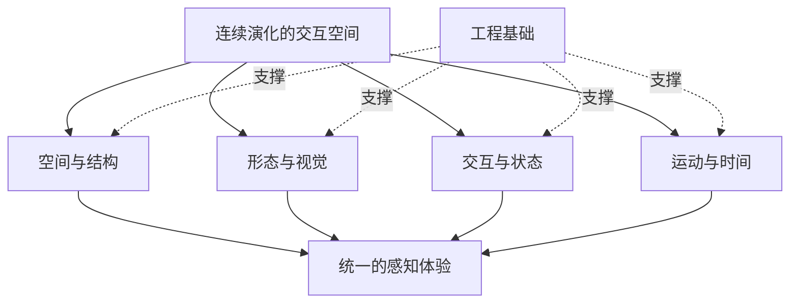

# 连续空间设计体系

*Continuous Spatial Design System*

## 一、核心设计哲学

**功能是存在的依据，空间是组织的载体，组件是空间中的实体，状态是实体的属性，交互是作用力，动效是演化过程，视觉是这一切的感知表达。**

界面是一个持续演化的数字空间，而非彼此孤立的页面集合。用户通过交互改变空间中的对象，对象依据统一的空间规则、功能逻辑与运动规律发生演化。

整体追求自然、克制、精致、灵动且富有秩序的体验。

- **空间统一性：** 一切对象存在于同一个具有内在秩序的空间。
- **对象连续性：** 一切变化都具有可追溯的身份、状态与因果关系。
- **感知自然性：** 视觉、交互与运动应符合人的感知直觉，并在此基础上追求优雅。

## 二、空间与结构

**1. 功能决定形态：** 组件的存在、形态、尺度、位置与视觉权重，应当源于其功能和信息价值。视觉表现建立在功能秩序之上，动效、材质与装饰共同强化功能表达和整体体验。

**2. 内容优先于容器：** 信息与功能是界面的主体，容器是组织内容的手段。优先通过留白、对齐、排版、疏密与空间距离建立内容关系，在存在明确的分组、隔离或层级需求时引入容器。

**3. 空间具有统一的秩序：** 将整个视窗视为具有位置、深度、层级、边界与遮挡关系的空间。组件的布局、投影、缩放、模糊及运动应遵循相互协调的空间规则。空间化是一种交互理念，而非对拟物化视觉风格的要求。

**4. 层级决定感知秩序：** 通过位置、尺度、色彩、对比度、留白与空间深度建立明确的主次关系。排版构成信息的结构骨骼，空间距离表达信息之间的归属关系，视觉权重引导用户的注意力。

**5. 复杂性随情境逐步展开：** 优先呈现当前情境下最有价值的信息与功能，将次级内容组织于合理的交互路径之中，使界面能够在简洁与丰富之间自然演化，同时保持必要功能的可发现性。

## 三、形态与视觉

**6. 几何具有连续性：** 组件的轮廓、比例、曲率、间距与嵌套关系应形成统一的几何语言。不同尺度的对象具有协调的形态特征，局部细节服从整体比例与视觉秩序。

**7. 光影与材质表达空间属性：** 通过统一的光照、阴影、透明度、模糊及材质关系表达对象的空间位置、表面性质与层级。材质的丰富程度应与对象的功能和视觉权重相匹配。

**8. 色彩承担语义与情绪：** 色彩同时服务于信息识别、功能反馈、视觉引导与氛围营造。以克制的基础色彩维持秩序，通过明度、饱和度、透明度和强调色建立富有层次的视觉表达。

**9. 一致性来自规则而非外形：** 组件应共享统一的几何、色彩、空间与交互语法，并根据功能、内容、视窗尺度与使用情境产生合理的形态差异。在变化中维持一致性，而非以重复的外形换取形式上的统一。

## 四、交互与状态

**10. 交互应具有直觉性：** 组件的形态、位置、文字、图标与状态应自然传达其功能和操作方式。优先让交互发生于对象本身或其邻近空间，建立用户意图与作用对象之间的直接联系。

**11. 输入与反馈紧密耦合：** 用户的操作应及时作用于界面，并产生清晰、准确且与操作强度相匹配的反馈。直接操控过程中，对象应自然跟随输入；操作结束后，再由适当的运动机制接管。

**12. 对象具有身份与状态连续性：** 同一对象在不同布局、尺寸、层级、页面与交互状态下，应尽可能保留其可辨识的身份。视觉状态、功能状态与交互状态相互协调，使每个中间状态都具有合理的逻辑意义。

**13. 交互权始终属于用户：** 动画和界面演化应能够响应新的用户意图。支持合理的中断、接管、反向操作与状态恢复，并兼顾不同输入方式、操作精度与感知能力，使交互始终处于用户的掌控之中。

## 五、运动与时间

**14. 动效是交互语言：** 动效承担状态反馈、功能引导、空间解释、注意力组织与情绪表达等职责。运动的形式应与交互行为的性质相匹配，使相同语义具有可辨识的运动特征。

**15. 物理直觉优先：** 对于具有空间属性的对象，优先采用符合物理直觉的运动模型。根据对象的尺度、速度、惯性及交互意图，合理选择临界阻尼、轻微欠阻尼或其他运动曲线。运动模型应服务于感知效果，而非机械地模拟现实物理。

**16. 演化具有因果与时间连续性：** 元素的出现、消失、位移、形变与状态切换，应具有可理解的来源、过程与结果。动画发生中断或目标改变时，应尽可能继承当前的位置、速度与运动趋势，使每一帧成为上一帧的自然延续。

**17. 节奏组织视觉叙事：** 依据功能层级、交互频率、运动尺度与信息量安排动画的速度、时长、错峰与重叠。主要运动建立视觉焦点，次级运动形成呼应与衔接；动与静共同构成完整的时间秩序。

## 六、感知与工程

**18. 氛围来自不同尺度的协同：** 宏观布局与大尺度动效构建空间感、节奏与整体气质；微观形态、材质细节与微动效赋予对象精致感和生命力。不同尺度的表现相互呼应，使氛围自然产生于整个界面。

**19. 流畅度与表现力共同优化：** 渲染流畅度是视觉与动效成立的基础。以中等偏上的设备性能为基准，充分利用合理的性能预算实现高品质表现，通过渲染优化、动画调度与自适应降级，在不同设备上尽可能保留核心视觉品质与运动语义。

**20. 感知品质应当具有稳定性：** 界面的可读性、操作热区、焦点状态、响应式布局与反馈机制应在不同设备、输入方式及使用环境下保持可靠。精致的视觉表现建立在稳定、准确、舒适的使用体验之上。

## 七、视觉语言规范

| 设计维度 | 表现规范 |
| --- | --- |
| 布局 | 开放式、低容器化、自然聚合、富有呼吸感 |
| 几何 | 优先采用超椭圆圆角或连续曲率轮廓，保持嵌套几何协调 |
| 光影 | 对具有浮起高度的对象，采用接触阴影、主体投影、环境阴影三层模型 |
| 材质 | 细腻、轻盈、具有空间属性，控制材质表现的强度与使用范围 |
| 色彩 | 克制的基础色彩、细腻的明度层次、具有明确语义的强调色 |
| 排版 | 清晰的信息层级、协调的比例、自然的疏密与阅读节奏 |
| 边界 | 优先以空间距离、明度差和材质差表达边界，按需使用描边 |
| 运动 | 平滑的物理运动、连续的形态演化、克制的回弹与错峰 |
| 氛围 | 宏观空间感与微观生命感相互协同 |

## 八、整体体系架构

| 体系层次 | 设计职责 | 核心要素 |
| --- | --- | --- |
| 空间与结构（Space） | 定义对象之间的关系 | 功能、布局、层级、信息组织 |
| 形态与视觉（Form） | 定义对象如何存在 | 几何、光影、材质、色彩 |
| 交互与状态（Interaction） | 定义用户如何影响对象 | 操控、反馈、状态、控制权 |
| 运动与时间（Motion） | 定义对象如何演化 | 物理、因果、连续性、节奏 |
| 感知体验（Perception） | 统一各层次的感知表达 | 秩序、自然、精致、灵动、克制；宏观空间感与微观生命感 |
| 工程基础（Engineering） | 支撑设计体系的稳定实现 | 渲染系统、物理动画系统、状态管理、设计令牌、自适应布局、可访问性、性能调度 |

## 九、设计决策的优先级

当不同设计原则发生实际冲突时，按照以下优先级进行权衡：

1. **功能与交互可靠性：** 正确、清晰、可控、可操作。
2. **感知与渲染连续性：** 即时响应、流畅、状态协调。
3. **空间与信息秩序：** 层级、归属、因果、认知效率。
4. **视觉与运动品质：** 比例、曲率、材质、物理直觉。
5. **情绪与氛围表达：** 优雅、灵动、精致、生命感。

这一顺序用于解决原则之间的实际冲突，而非逐级牺牲后面的设计价值。设计应主动寻找功能、性能与审美之间的协同关系。
